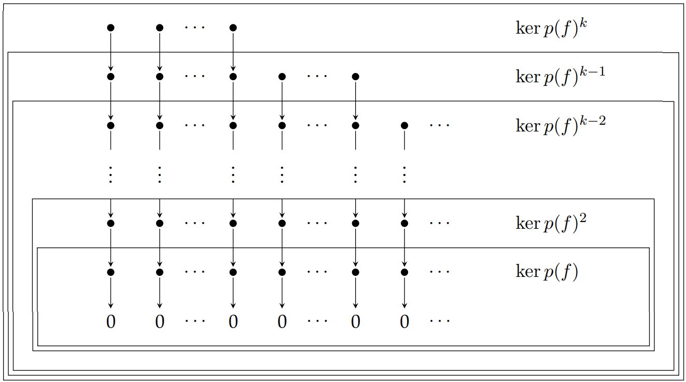

Una [[Base o sistema generador minimal|base]] de $\text{ker }p(f)^n$ formada por ==cadenas de bloques== se puede representar mediante el siguiente diagrama donde los puntos representan bloques de vectores, cada uno con base $\{v, f(v), \dots , f^{\text{deg }p(x)-1} (v)\}$.

>[!example] Proposición
>En el diagrama de una base de cadenas de bloques de $\text{ker }p(f)^n$ los vectores de los bloques de las $k$ filas más bajas forman una base de $\text{ker }p(f)^k$.

>[!tip] Técnica: Cálculo de una base formada por cadenas de $\text{ker }p(f)^n$
>Primero buscaremos el valor $k$ más pequeño tal que $\text{ker }p(f)^k = \text{ker }p(f)^n$. Este $k$ será el tamaño de la cadena de vectores más larga y podremos buscar un comienzo de cadena gracias a que $\text{ker }p(f)^{k-1} \lneq \text{ker }p(f)^k$. Así que:
>1. Los nodos de la fila más alta se obtienen completando una base de $\text{ker }p(f)^{k-1}$ hasta una base de $\text{ker }p(f)^k$.
>2. Los nodos de la fila $i$ completan una base de $\text{ker }p(f)^{i-1}$ hasta una de $\text{ker }p(f)^i$.
>3. Los nodos de la primera fila son una base del [[Imagen, preimagen y núcleo|núcleo]] de $p(f)$.
