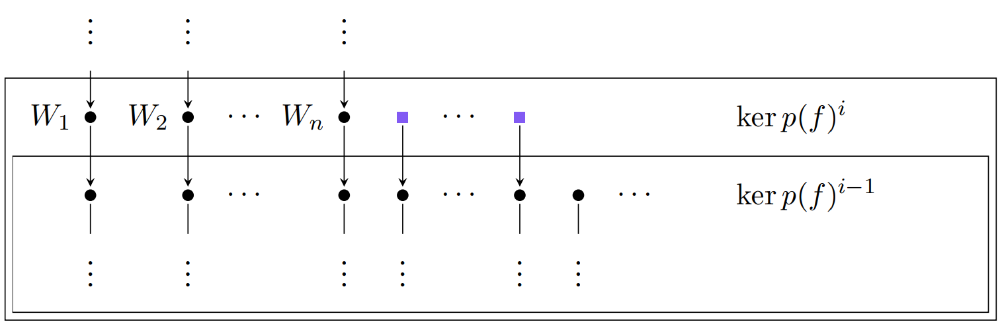

Para conocer el número de cadenas de bloques de una determinada longitud podemos usar el siguiente resultado que emplea la dimensión de los distintos núcleos.

>[!example] Proposición
>Sea $p(x)$ un [[Polinomio|polinomio irreducible]] divisor de $p_f (x)$ con multiplicidad $n$. El número de cadenas de longitud $m$ en una [[Base de cadenas de bloques|base de cadenas de bloques]] de $\text{ker }p(f)^n$ es
>$$
>n_m = \frac{2\text{ dim ker }p(f)^m -\text{ dim ker }p(f)^{m+1} -\text{ dim ker }p(f)^{m-1}}{\text{deg }p(x)}
>$$

>[!tip] Técnica: Calcular la cabeza de cadenas que no son las más largas
>Para encontrar los vectores iniciales de longitud $i$ de la siguiente figura, señalados por un cuadrado ■, debemos completar una [[Base o sistema generador minimal|base]] de
>$$
>\text{ker }p(f)^{i-1} \oplus W_1 \oplus W2 \oplus W_n
>$$
>hasta una base de $\text{ker }p(f)^i$, siendo $W_j = \text{Gen}⟨w_j , f(w_j ), \dots , f^{k-1} (w_j)⟩$.
>